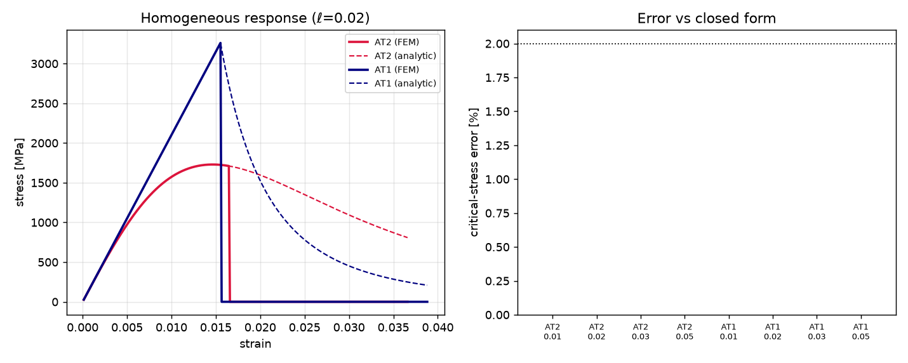
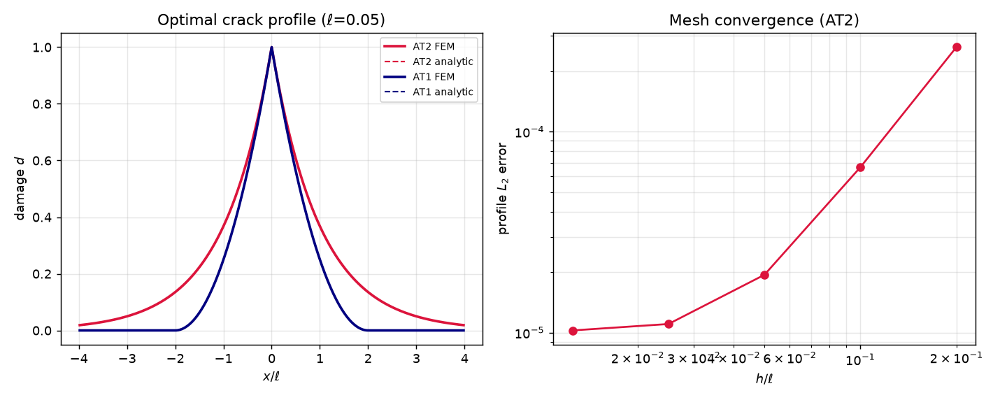
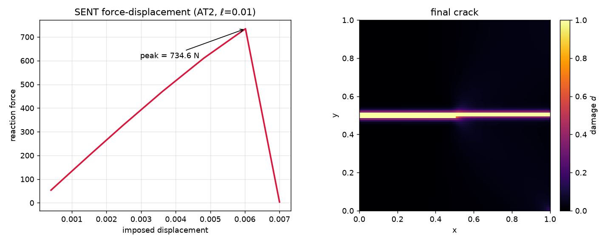
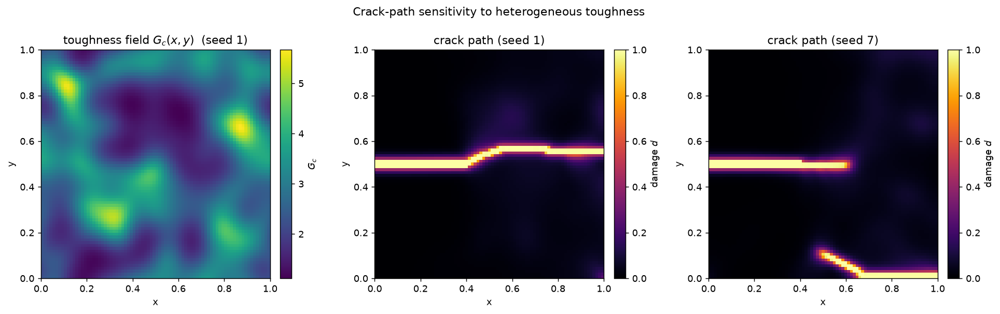
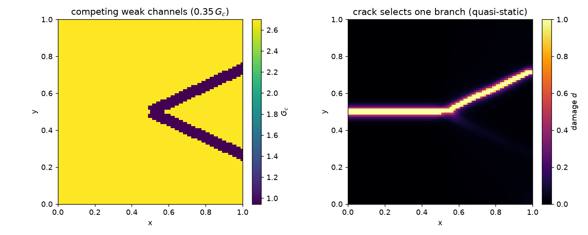
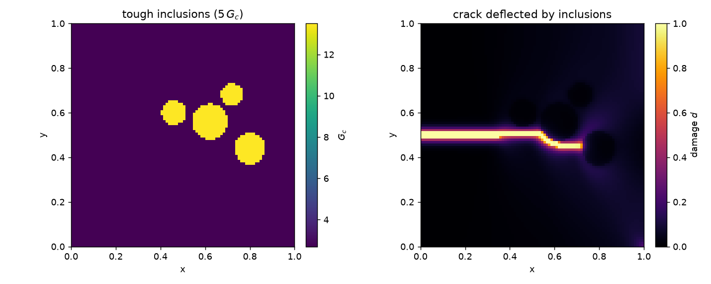

# phasefield-fracture

**Computational modelling of crack propagation in heterogeneous materials** —
a compact, self-contained phase-field solver for brittle fracture, written in
pure NumPy/SciPy and *verified against closed-form solutions*.

The model (Ambrosio–Tortorelli AT1/AT2 regularization of Griffith fracture,
history-field irreversibility, volumetric–deviatoric energy split) mirrors the
[PhaseFieldX](https://github.com/CastillonMiguel/phasefieldx) / FEniCSx
community formulation, so results are directly comparable — but it runs
anywhere Python does, with no FEniCSx/DOLFINx/MPI toolchain required.

> Built as a focused study of crack propagation in **heterogeneous** media:
> spatially varying fracture toughness, crack-path deflection and sensitivity,
> crack branching, and quantitative comparison with analytical benchmarks.

---

## Why this project

Phase-field fracture is the modern variational way to simulate cracks: no crack
tracking, no remeshing, and nucleation, propagation, branching and merging all
emerge from energy minimization. This repository implements the method from
scratch and — crucially — **proves it is correct** by reproducing the
analytical results the theory guarantees, to within a fraction of a percent.

## Highlights

- **AT1 and AT2** phase-field models with a true closed-form–matched critical stress.
- **Heterogeneous toughness** `Gc(x, y)`: random fields, layered media, circular inclusions.
- **Staggered solver** with history-field irreversibility and a box-constrained
  damage update (primal–dual active set; projected SOR for verification).
- **Adaptive load stepping** — large increments in the elastic regime, small
  ones through brittle propagation.
- **Verification suite** against closed forms, wired into `pytest`.
- Pure NumPy/SciPy. Vectorized assembly (identical-cell reference operators).

## Verification — accuracy against closed-form solutions

Run `python validation/val01_critical_stress.py` etc. All numbers below are
produced by the scripts in [`validation/`](validation/).

| Benchmark | Quantity | Reference | Error |
|---|---|---|---|
| Homogeneous critical stress, **AT2** (ℓ = 0.01–0.05) | σ_c | `(3/16)√3·√(E·Gc/ℓ)` | **0.00 %** |
| Homogeneous critical stress, **AT1** (ℓ = 0.01–0.05) | σ_c | `√(3E·Gc/8ℓ)` | **0.00 %** |
| Optimal crack profile, **AT2** | `d(x)` vs `e^{-|x|/ℓ}` | L2 norm | **< 0.001** |
| Optimal crack profile, **AT1** | `d(x)` vs `(1-|x|/2ℓ)²` | L2 norm | **< 0.001** |
| Dissipated energy (Γ-convergence), AT1 & AT2 | `E_frac` vs `Gc` | energy | **≤ 0.01 %** |
| 2-D SENT crack | `E_frac / Gc` vs crack length | energy consistency | see `val03` |

The full homogeneous stress–strain response and the crack profiles also match
the analytical curves point-by-point:




## Examples (heterogeneous crack propagation)

### 1. Single-edge-notched tension (SENT) — the classic Miehe benchmark
A pre-cracked square plate pulled in tension; the crack runs straight across.
The force–displacement curve shows the elastic rise, peak load, and the
characteristic brittle snap as the crack propagates.

```bash
python examples/ex01_sent.py --n 100
```


### 2. Crack-path sensitivity in a random toughness field
The same notch in a plate with a spatially correlated random `Gc(x, y)`: the
crack deflects toward weaker material, and different microstructures (random
seeds) produce different crack paths.

```bash
python examples/ex02_heterogeneous.py --n 100
```


### 3. Crack branching along weak channels
Branched crack morphology controlled by material heterogeneity (two diverging
low-toughness channels ahead of the notch).

```bash
python examples/ex03_branching.py --n 110
```


### 4. Crack deflection by tough inclusions
A crack repelled by stiff, tough circular particles, weaving between them — a
canonical crack/microstructure interaction problem.

```bash
python examples/ex04_inclusions.py --n 120
```


## Install & run

```bash
git clone https://github.com/vikranthacker/phasefield-fracture.git
cd phasefield-fracture
pip install -r requirements.txt      # numpy, scipy, matplotlib, pytest
# or:  pip install -e .

pytest -q                            # run the verification tests
python validation/val01_critical_stress.py
python examples/ex01_sent.py --n 100
```

## Quickstart (API)

```python
import numpy as np
from phasefield import (StructuredMesh, Material, PhaseFieldModel,
                        StaggeredSolver, adaptive_load, materials)

mat  = Material(E=210e3, nu=0.3, Gc=2.7)                 # N, mm, MPa
mdl  = PhaseFieldModel(mat, ell=0.012, variant="AT2", split="isotropic")
mesh = StructuredMesh(1.0, 1.0, 100, 100)

# heterogeneous toughness: tough circular inclusions
Gc = materials.circular_inclusions(mesh, mat.Gc,
                                   inclusions=[(0.6, 0.55, 0.08)],
                                   Gc_inclusion=5 * mat.Gc)
solver = StaggeredSolver(mesh, mdl, Gc_elem=Gc)

# seed a pre-crack, define tension BCs, and load adaptively
gp = mesh.gauss_point_coords()
solver.seed_crack((np.abs(gp[..., 1] - 0.5) < 0.7 * mesh.hy) & (gp[..., 0] <= 0.4))
top = mesh.nodes_where(lambda x, y: y > 1 - 1e-9)
bot = mesh.nodes_where(lambda x, y: y < 1e-9)
bc = lambda U: (np.concatenate([2*bot, 2*bot+1, 2*top+1]),
                np.concatenate([np.zeros(2*len(bot)), np.full(len(top), U)]))

history = adaptive_load(solver, bc, reaction_dofs=2*top+1, U_max=8e-3, dU0=4e-4)
```

## Project layout

```
phasefield/           core library
  mesh.py             structured Q1 mesh + reference element operators
  model.py            material, AT1/AT2 model, energy split
  fem.py              vectorized assembly, Dirichlet BCs, box-QP solvers
  solver.py           staggered solver + adaptive load stepping
  materials.py        heterogeneous Gc fields (random / layered / inclusions)
  analytic.py         closed-form reference solutions
  onedim.py           1-D solver used for verification
  postprocess.py      plotting / export helpers
examples/             ex01 SENT, ex02 heterogeneous, ex03 branching, ex04 inclusions
validation/           val01 critical stress, val02 profile, val03 energy/Griffith
tests/                pytest verification suite
docs/theory.md        model, discretization, algorithm, references
```

See [`docs/theory.md`](docs/theory.md) for the full formulation.

## Scope and limitations (honest notes)

- **Quasi-static.** The solver minimizes energy incrementally; it captures
  nucleation, stable/unstable propagation, deflection and quasi-static
  branching. Fully *dynamic* branching (inertia-driven, above a critical crack
  speed) requires adding a mass term and explicit time stepping — listed as
  future work. Example 3 produces a branch via heterogeneity, not inertia.
- **2-D plane strain, small strain, isotropic linear elasticity.**
- **Structured mesh.** A graded/unstructured mesh would resolve the crack band
  (needs `h ≲ ℓ/2`) more economically; here resolution is set globally.
- **Direct sparse solves** (SciPy SuperLU): excellent up to ~10⁴–10⁵ dofs, which
  is the practical range for a pure-Python solver.

## Relation to PhaseFieldX

[PhaseFieldX](https://github.com/CastillonMiguel/phasefieldx) is a FEniCSx-based
framework for phase-field simulation. This project implements the same
underlying models (AT1/AT2, `(1-d)²` degradation, history-field irreversibility,
energy splits) independently in NumPy/SciPy, trading FEniCSx's generality and
performance for zero-dependency portability and transparency — every line of the
method is in this repo and checked against analytical benchmarks.

## References

Bourdin–Francfort–Marigo (2008); Miehe et al. (2010); Amor et al. (2009);
Pham et al. (2011); Tanné et al. (2018). Full citations in
[`docs/theory.md`](docs/theory.md).

## License

MIT — see [LICENSE](LICENSE).
